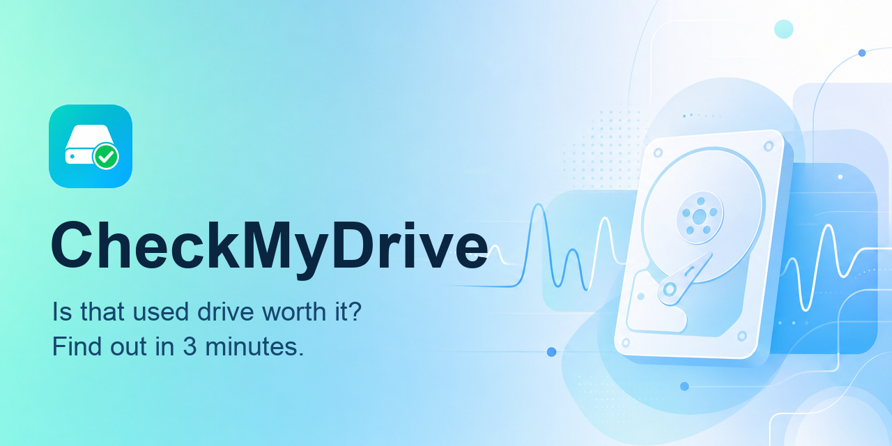
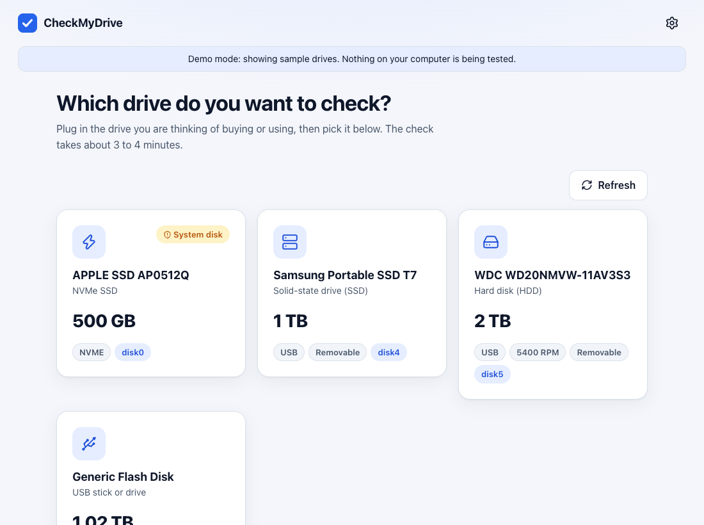
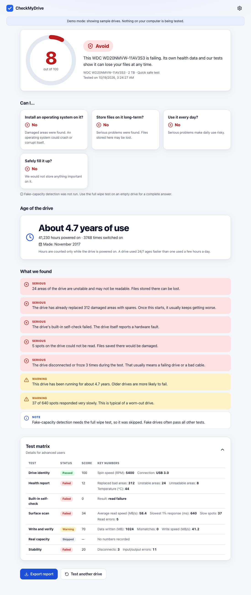
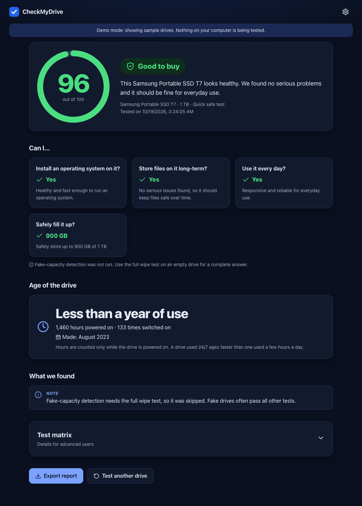

<p align="center">
  
</p>

<p align="center"><b>Find out in about four minutes whether a used hard drive, SSD, USB stick or SD card is safe to buy or use.</b></p>

<p align="center">
  <a href="https://github.com/humza-sami/checkmydrive/releases/latest"></a>
  <a href="https://github.com/humza-sami/checkmydrive/actions/workflows/ci.yml"></a>
  <a href="LICENSE"></a>
  
</p>

## Why this exists

I bought a used 2 TB drive for a home server. It looked fine, but it kept disconnecting, and every big transfer failed halfway. By the time I understood why, I had lost days of work. Nothing in a normal file manager tells you a drive is quietly dying. CheckMyDrive runs the checks I wish I had run before paying, and gives you a plain answer: buy it, be careful, or walk away.

## What it checks

CheckMyDrive runs seven tests:

- **Drive info**: identifies the model, type, capacity and how long the drive has been in use.
- **Health report (SMART)**: reads the drive's own health data, including the overall verdict, bad or remapped sectors, cable/connection errors, SSD wear and temperature.
- **Built-in self-test**: asks the drive to run its short self-check (skipped if the drive does not support it).
- **Surface read**: reads many spots across the whole drive, plus a 15 second sequential read, and counts errors and slow responses.
- **Write and verify**: writes data, reads it back without help from caches, and checks it matches.
- **Capacity check**: detects fake-capacity drives that claim more space than they have (full wipe test only).
- **Stability**: watches for the drive disconnecting, I/O errors and timeouts while all this happens.

You get:

- A **score out of 100** and a verdict: **buy**, **caution** or **avoid**.
- Plain answers to: can I **install an operating system** on it, is it OK for **long-term storage**, is it OK for **daily use**, and **how much can I safely fill**.
- An estimate of the drive's **age** (power-on time and power cycles).
- A list of **issues** found, sorted from critical to informational.
- A **test matrix** showing the result and score of each test.

## Screenshots

| Pick a drive | Result: avoid | Result: good (dark) |
|---|---|---|
|  |  |  |

## Download and install

Get the latest build from the [Releases page](https://github.com/humza-sami/checkmydrive/releases/latest).

| System | File | Notes |
|---|---|---|
| macOS | `.dmg` (universal: Apple Silicon and Intel) | Open it and drag the app to Applications. Releases are signed and notarized when the signing credentials are available. If macOS says it can't verify the developer, right-click the app and choose **Open**. |
| Windows | `.exe` installer or `.msi` | If SmartScreen warns you, choose **More info**, then **Run anyway**. |
| Linux (Debian/Ubuntu) | `.deb` | `sudo apt install ./CheckMyDrive_*.deb` (pulls in `smartmontools` and PolicyKit). |

**Why it asks for your password or admin rights:** reading a drive's SMART health data and reading raw disk sectors are privileged operations on every operating system. On macOS you get a password prompt when a test starts, on Linux a PolicyKit prompt, and on Windows the app starts as administrator.

## Is it safe?

- **Quick safe test** (the default) never touches your files. It reads the drive read-only, and writes exactly one temporary file (`.checkmydrive-*.tmp`, at most 1 GiB or 5% of free space) into free space, then deletes it, including if you cancel.
- **Full wipe test** is for drives you have just bought or have no data on. It **destroys data on the drive**, so back up first. It unmounts the drive, requires you to type the drive's serial number, and **always refuses your system disk**. It overwrites a limited set of regions rather than every sector, but treat the drive as erased afterwards.
- **Nothing leaves your computer.** There is no telemetry, no analytics and no network access. The code contains no HTTP client, and the app's content security policy allows only local connections. The only URL in the interface is a link to this repository's page. You can check with `grep -rnE "fetch\(|https?://" app/src app/src-tauri/src engine/src`.

## How the score works

The score starts at 100 and drops for each issue found, by severity. Some findings also cap the score no matter what else passes:

| Finding | Score cannot exceed |
|---|---|
| Fake capacity detected | 5 |
| SMART overall health says FAILED | 10 |
| Drive disconnected during the test | 25 |
| Read errors | 30 |
| SSD wear 90% or more used | 40 |
| More than 100 reallocated sectors | 40 |
| Pending or uncorrectable sectors | 45 |
| Any reallocated sectors | 70 |

| Score | Verdict |
|---|---|
| 80 to 100 | **Buy** |
| 50 to 79 | **Caution** |
| below 50 | **Avoid** |

Suitability: "install an OS" needs a score of 80 or more, no pending or reallocated sectors and good latency. "Long-term storage" needs 75 or more and no critical issues. The recommended fill level is 90% (score 80+), 60% (65 to 79), 30% (50 to 64) or 0% (below 50). Full details are in [docs/CONTRACT.md](docs/CONTRACT.md).

## Limitations

- Drives rarely report a manufacture date, so age is estimated from power-on hours when the drive provides them.
- The quick test samples the surface (at least 512 spots plus a sequential read). It does not read every sector, so it can miss small bad areas.
- Some USB enclosures hide SMART data. The app tries several bridge types, but if it still cannot read SMART, those tests are skipped and the score relies on the rest.
- Fake-capacity detection needs the full wipe test, because it has to write across the whole claimed size.
- Windows and Linux support has had much less real-hardware testing than macOS. Please report problems.

## Languages

The interface is available in 40 languages, and picks yours automatically:

English, Español, 简体中文, 繁體中文, हिन्दी, العربية, বাংলা, Português (Brasil), Português (Portugal), Русский, 日本語, Deutsch, Français, اردو, Bahasa Indonesia, Türkçe, 한국어, Tiếng Việt, Italiano, فارسی, Polski, Українська, Nederlands, ไทย, Bahasa Melayu, Română, Ελληνικά, Čeština, Svenska, Magyar, עברית, Dansk, Suomi, Norsk, Slovenčina, Български, Kiswahili, தமிழ், తెలుగు, मराठी.

Right-to-left languages display correctly. To fix or improve a translation, or add a language, see [CONTRIBUTING.md](CONTRIBUTING.md): translation files are plain JSON in `app/src/locales/`.

## Build from source

Prerequisites: [Rust](https://rustup.rs) (stable), Node.js 22 or newer, and on Linux the Tauri dependencies:

```sh
sudo apt-get install -y libwebkit2gtk-4.1-dev libappindicator3-dev librsvg2-dev patchelf smartmontools
```

```sh
# 1. Build the engine and install it as the app's sidecar
scripts/build-sidecar.sh "$(rustc -vV | sed -n 's/^host: //p')"   # Windows: scripts/build-sidecar.ps1 <triple>

# 2. Run the app in development
cd app && npm ci && npm run tauri dev

# UI only, with fake drives and no engine (works in a plain browser too)
cd app && VITE_MOCK=1 npm run dev
```

Run the tests:

```sh
cd engine && cargo test && cargo clippy --all-targets
cd app && npx vitest run
```

The engine also works on its own from the command line and prints JSON:

```sh
checkmydrive-engine list                                  # no admin needed
checkmydrive-engine test --drive disk4 --mode safe        # needs admin/root
checkmydrive-engine test --drive disk4 --mode wipe --confirm-serial <serial>   # DESTRUCTIVE
checkmydrive-engine version
```

## Project structure

```
checkmydrive/
├── engine/       Rust crate: all disk logic, CLI that emits JSON
├── app/          Tauri v2 desktop app (React + TypeScript)
│   ├── src/      Interface and translations (src/locales)
│   └── src-tauri/  Tauri shell
├── docs/         Architecture contract and screenshots
├── scripts/      Sidecar build scripts
└── .github/workflows/  CI and release builds
```

The engine and the app only talk through the contract in [docs/CONTRACT.md](docs/CONTRACT.md).

## Contributing

Bug reports, translations and pull requests are welcome. See [CONTRIBUTING.md](CONTRIBUTING.md).

## License

[MIT](LICENSE) © 2026 humza-sami

## Acknowledgements

Drive health data comes from [smartmontools](https://www.smartmontools.org) (`smartctl`). The desktop app is built with [Tauri](https://tauri.app).

## Disclaimer

CheckMyDrive is provided as is, without warranty of any kind. Results are guidance, not a guarantee: a drive that scores well can still fail, and a poor score does not prove a drive is unusable. Always keep backups of data you care about, and back up before running the full wipe test.
